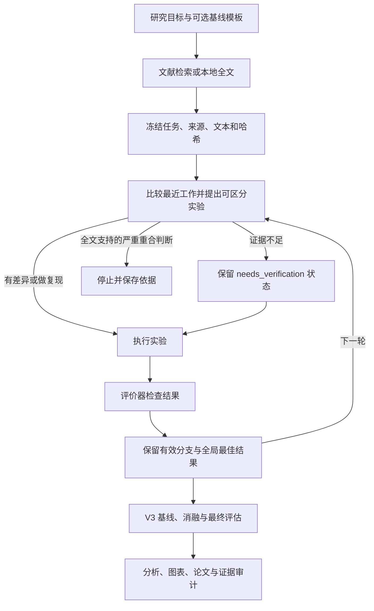

# Unified AI Scientist：V1–V3 融合研究系统

本项目实际复用 V1 的 idea 反思代码、V2 的 Journal 与 MetricValue 代码，并接入自适应阶段控制器和 V3 执行、评价、论文及审稿流程。完整入口为 `scripts/research-agent harness`，也可使用 `agsci research harness`。

先看[完整 Harness 使用指南](docs/research-harness.zh-CN.md)和[V1–V3 代码复用清单](docs/upstream-code-reuse.md)。清单列出固定 commit、来源文件、实际调用位置、修改和许可证。V3 保留 Apache-2.0；V1/V2 适配代码保留 AI Scientist Source Code License v1.0。尚未通过同预算基准证明本项目优于三个原始版本。

完整流程涵盖全文检索、研究议程、独立创新性审查、自适应实验、对照消融、隔离确认、论文、审稿与修改。就绪报告分别检查代码执行、科研证据和论文质量。当前自适应调查使用单 worker；macOS 完整执行使用 Linux coordinator，以保留原有文件和恢复检查。[新的病理 CPU 契约任务](examples/pathmnist_mil_harness/README.md)用于端到端验收。

[如何增加预算并提高研究质量](docs/research-quality-guide.zh-CN.md)：分别设置文献预算、agent 推理、搜索轮次和实验重复，避免只增加 token 却重复低质量实验。

[研究方法学集成说明](docs/research-methodology.zh-CN.md)：六项技能原则如何进入实际阶段提示、冻结版本与哈希，以及通用和医疗研究的方法卡、证据缺口与检查边界。

已通过本机 Magpie 的真实 GPT 调用完成一个[快速弱监督病理案例](docs/pathmnist-mil-pilot-2026-10-18.md)：文献检索、idea、候选代码、宿主评分和搜索后留出检查。两个候选均未超过基线。案例同时发现并修复了基线初始化、树配置传递和提示词约束等集成问题。[直接运行该案例](examples/pathmnist_mil/README.md)。

最新[改进与验证报告](docs/fusion-improvements-2026-10-18.md)包含临时 API 错误恢复、实际预算传递、评价输入校验与多 seed 协议，以及 418 项通过的回归测试、54 次训练预算校准和六轮真实搜索。开发分数从基线 0.58353 提高至 0.58993；该均值提升尚无独立确认，也未超过校准中的普通 LME 对照。

## 三个版本各自的长处

| 版本 | 核心做法 | 值得保留的长处 | 主要边界 |
|---|---|---|---|
| V1（2024） | 从实验模板开始，生成 idea、检索相近工作、改代码、实验、写作和评审 | 起点明确，已有基线便于排错，流程容易检查 | 依赖模板覆盖范围，主要按顺序迭代，新颖性检查不是可靠的科研结论 |
| V2（2025） | 减少手写模板依赖，按可行性、调参、研究、消融分阶段做树搜索，结合视觉反馈 | 保留多个实验方向，阶段清楚，重视重复实验和图表反馈 | 搜索增加成本，自动评审仍需独立核查 |
| V3（2026） | 通用 coding agent、多 worker 搜索、共享记忆、任务契约、最终评估、基线和消融、证据约束写作 | 工程链路完整，支持多种 agent，实验产物与论文主张的关系更清楚 | 固定文献检索在写作阶段；复杂任务自动构建、从文献构造 SOTA 基线仍有限制；分数提升不代表新颖性 |

来源：[V1 论文](https://arxiv.org/html/2408.06292v1)、[V2 论文](https://arxiv.org/html/2504.08066v1)、[V3 论文](https://arxiv.org/html/2610.18933v1)与[官方 V3 仓库](https://github.com/SakanaAI/AI-Scientist-v3)。表中的长处是工程判断，不是跨版本统一测试的排名。

V2 报告的是 ICLR 2025 **workshop** 评审结果，不能写成主会接收。V3 的 ALIFE 2026 案例有人类共同研究者核查和修改，不能作为完全无人参与的证据。不同案例不能直接证明版本间的性能优劣。

## 整合方式



| 组成 | 实际行为 | 来源与性质 |
|---|---|---|
| 可复用起点与反思 | 复用任务模板；研究议程按有界循环生成、反思、解析并保存每一轮 | V1 `generate_ideas.py` 反思代码已适配并实际调用；模板沿用 V3 |
| 文献与引用 | 可配置模型 API 联网检索并解析返回文本；读取公开 PDF 或本地全文，保存来源、哈希和可定位片段；写作阶段从原始来源核对引用字段 | 借鉴 V1/V2，将检索接到实验前，并接入 V3 论文流程；整合任务不依赖 Semantic Scholar API |
| 差异记录 | 每个 idea 记录最近工作、重合、差异、替代解释和判别实验；引用须定位到保存文本 | 本次新增的证据连接层 |
| 分支搜索 | V2 Journal 和 MetricValue 排序实际宿主验证节点，保留分析、失败分支和 debug depth；冻结重复不参与晋级 | 直接适配 V2 源码，通过固定来源与测试记录追溯 |
| 自适应阶段 | 基线资格、调参、冻结重复、机制探索、细化、重复与确认交接；改善、停滞和预算决定转换 | 本次控制器复用 V3 执行器，消融与独立确认由外围流程执行 |
| 预算与恢复 | 持久化待完成工作和评价回执；网络失败与科学负结果分别计数；恢复复用已验证结果 | 中断点与扩大外层轮次后的恢复已有定向测试 |
| 开发评价 | 原生宿主评分模式将分数绑定程序、评价器和声明的依赖；PathMNIST 支持冻结多 seed 协议和置换检查 | 开发验证能力，不等于容器隔离或独立确认 |
| 实验与写作 | 复用 V3 的隔离、任务契约、基线/消融、最终评估、图表和论文审计 | 上游已有能力；本次将文献比较接入论文数据 |

每棵树的候选池最多包含分数最高的 `width` 个有效节点，加初始基线。历史节点保留。低分有效节点可以继续探索，但不替代全局最佳结果。`tree` 模式与历史目录 pruning 互斥。原有 `agsci run` 默认仍使用 `best` 策略。

## 开始使用

按[上游安装说明](docs/install.md)准备 Python。中国大陆环境可用镜像安装锁定依赖：

```bash
uv sync --frozen --group dev --index-url https://mirrors.aliyun.com/pypi/simple
source .venv/bin/activate
```

主机脚本需要 GNU Bash 4 或以上。macOS 的系统 Bash 3.2 不够；可使用 Homebrew Bash。新入口会识别 Homebrew 或项目内 `scratch/tools/bin/bash`，并为临时文件设置规范路径。本工作区已准备项目内 Bash 5.2.37。

从仓库根目录创建 CPU 示例。`prepare` 准备输入和文献，会使用已配置的检索模型 API；它不启动实验 coding agent，也不训练模型。先按[多模型检索配置指南](docs/model-search.zh-CN.md)设置服务、模型和 key。

```bash
./scripts/research-agent init playground/circle-study --template circpack \
  --provider openrouter --model '填入模型ID' \
  --query "circle packing unequal circles unit square optimization"

# 配置预览：不创建工作区、不联网。
./scripts/research-agent run playground/circle-study \
  --workspace results/unified/circle-study --dry-run agent.name=codex

# 在线检索；加 --offline 可只使用配置中列出的本地来源。
./scripts/research-agent prepare playground/circle-study \
  --workspace results/unified/circle-study agent.name=codex
```

检查 `input_task/research_context/README.md` 和 `catalog.json`。检索失败或只有摘要时，在原始项目添加合法取得的全文，更新 `research.yaml`，再使用新的工作区。冻结输入不能被静默改写。

默认的容器完整流程需要 V3 的 Docker agent 镜像，以及所选 agent 的凭据。镜像构建见[安装说明](docs/install.md#docker-image)。本扩展不复制个人凭据，认证沿用 V3。快速病理案例使用显式配置的本机开发模式，不提供容器文件隔离。

```bash
./scripts/local-agsci doctor playground/circle-study agent.name=codex

# 从准备好的输入开始完整流程。
./scripts/research-agent run --resume results/unified/circle-study \
  investigation.execution.max_idea_cycles=3 \
  ablations.execution.num_replications=1 \
  ablations.execution.max_evals_per_variant=2 \
  posthoc.execution.max_selected_analyses=1

./scripts/research-agent report results/unified/circle-study
```

这些小预算用于首次连通检查，不足以支持论文级结论。中断后继续用同一 `--resume` 路径。恢复行为沿用 V3，不保证重放中断的单次 agent 操作。并行参数是 `investigation.execution.workers`；各 worker 的树独立，记忆同步沿用 V3。

`--dry-run` 检查研究配置和 Hydra 配置组合，显示传给执行引擎的参数。新的 `run` 会在文献检索前检查本地 CLI、任务脚手架，以及所需的镜像、环境文件和 GPU。它不试用远端账户，也不启动训练；评价器和依赖的实际运行仍由正式流程检查。`prepare` 只准备研究输入，不要求已装好执行环境。

## 添加领域文献

把全文放入项目，例如 `papers/closest_method.pdf`，再编辑 `research.yaml`：

```yaml
schema_version: 1
literature:
  queries:
    - "your task nearest method controlled comparison"
  sources:
    - id: closest_method
      title: "填入真实论文标题"
      year: 2025
      venue: "填入真实期刊或会议"
      url: "https://example.org/replace-with-actual-paper"
      path: papers/closest_method.pdf
  max_papers: 8
  results_per_query: 5
  fetch_full_text: true
  timeout_seconds: 15
  proxy_fallback: http://127.0.0.1:7890
  model_search:
    provider: openrouter
    model: "填入模型ID"
    api_key_env: OPENROUTER_API_KEY
search:
  strategy: tree
  width: 4
  explore_every: 3
```

这是字段示例，须替换标题、链接、文件和模型 ID。纯在线检索可设 `sources: []`。本地来源支持 `.pdf/.txt/.md`。key 通过环境变量传入。可以换用其他服务；[配置指南](docs/model-search.zh-CN.md)和[28 份模板](configs/research-providers/README.md)说明了原生联网、普通模型加搜索后端、自定义地址和代理的用法。

来源状态为 `metadata`、`abstract`、`full_text` 或 `full_text_partial`。模型生成的摘要仅保存在 `model_summary`，不能作为原始摘要或全文。扫描 PDF 需要先 OCR。全文可用不等于完整阅读或判断正确。自动片段只是阅读入口，agent 可以读取全文并引用任意有效字符区间。

| `research_basis.status` | 行为 |
|---|---|
| `differentiated` | agent 判断有可解释差异；要求全文引用，仍需独立核查 |
| `needs_verification` | 证据不足；可继续探索，论文须保留不确定性 |
| `replication` | 作为复现研究，不包装成新方法 |
| `collision` | agent 判断问题、方法和贡献严重重合；要求全文引用，停止并保存依据 |

引用校验拒绝不存在的来源、越界片段和被改写的文本。它不能自动证明片段支持某个语义结论。最终新颖性和有效性仍需研究者核对。

## 输出与检查

```text
results/unified/circle-study/
├── input_task/                   # 冻结的任务、配置、原始文献
│   └── research_context/         # catalog.json、来源说明、抽取文本、模型检索响应
├── research_manifest.json        # 输入哈希与启动参数
├── research_execution.json       # 正式运行后保存的最近一次模型与预算参数
├── research_report.json          # 退出码、来源状态、树和 idea 判断
├── research_report.md
└── run/                          # V3 正式流程
    ├── task/
    ├── investigation/            # 树、ideas、最佳候选等
    ├── ablations/
    ├── final_evaluation/
    ├── posthoc/
    └── paper/
```

并行时，`search_tree.json` 在各 worker 的结果目录。`pipeline_returned` 只表示执行器返回 0，不表示结论成立。报告固定保留 `research_validity: requires_evidence_review`。论文数据保留 idea 比较及来源；写作和审计要求保留复现、负结果和未核实状态。

开发验证见[验证记录](docs/unified-research-validation.md)。入口代码在 [src/research](src/research)，树策略在 [search_tree.py](src/investigation/search_tree.py)。

## 如何验证是否更强

在同一模型、任务、评价器、数据划分、实验次数和 token 预算下比较：原始 V3、V3 加前置文献、V3 加分支搜索，以及本整合版。

分别报告有效运行率、最终保留集表现、重复实验方差、每项有效改进的费用，以及人工盲审的引用准确率和贡献可信度。先用 CPU 任务排查流程，再进入有可信基线的医疗 AI 任务。不要仅用自动 reviewer 分数定义成功。

这是工程整合。当前没有证据把“组合三个版本”写成算法创新。若后续实验表明具体机制解决了明确问题，再形成可检验的研究贡献。
