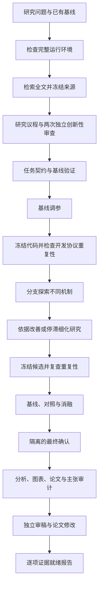

# 完整科研 Harness

`scripts/research-agent harness` 将研究准备、实验、论文和审稿放在同一工作区。它复用 V3 执行器，并增加可恢复的阶段控制器、全文支持的创新性审查和证据就绪报告。目标是提高研究质量与可检查性。论文是否达到某个期刊或会议的标准，仍取决于实际贡献和证据。

## 工作流程



探索期间使用开发数据。阶段结束后的冻结重复检查仍属于开发证据。最终确认使用任务契约声明的另一组 seed 和隔离资源。增加 seed 不能代替新数据、患者独立性或外部队列；这些要求必须写入具体任务。

## 三个版本如何整合

| 来源 | 本项目保留的机制 | 实际实现 |
|---|---|---|
| V1 | 可复用任务起点、idea 有界反思、实验记录 | 实际适配 `generate_ideas.py` 的反思循环；每轮保留完整证据和模型回执 |
| V2 | Journal、MetricValue、分支选择、分阶段研究 | 实际源码适配负责节点排序和分支语义；`AdaptiveController` 根据有效结果、改善、停滞和预算切换阶段 |
| V3 | coding agent、任务契约、封闭评价、对照消融、最终确认与论文审计 | 复用原有 pipeline 和执行器；每个阶段写入宿主生命周期记录 |
| 本次整合 | 把文献差异与实验依据连接起来 | 研究议程、最近工作全文片段、替代解释、判别实验、独立创新性审查与就绪报告 |

来源与修改见[实际代码复用清单](upstream-code-reuse.md)。V1/V2 适配模块保留原 AI Scientist Source Code License，V3 保留 Apache-2.0。运行时不依赖审查用的上游 checkout。三个版本继续共用一个执行链。

## 安装与运行

先准备 Python 环境、Docker 和所用 agent 的认证。现有完整 agent 镜像支持多个 agent。CPU/Codex 任务也可使用较小的专用镜像：

```bash
uv sync --frozen --group dev --index-url https://mirrors.aliyun.com/pypi/simple
./scripts/build-research-cpu-image.sh
```

专用镜像包含 Codex、固定版本的 Headless、Python、LaTeX 和 PDF 工具。任务自己的依赖由受管理的任务环境安装。镜像不包含个人凭据，也不包含 GPU/PyTorch 训练环境。

macOS 完整运行还需要 Linux 运行器。运行状态和临时文件必须放在 Docker 原生 volume 中。macOS 共享目录不能可靠执行这里使用的原子目录替换和恢复操作；启动检查会在调用模型前发现这类问题。

```bash
./scripts/build-research-runner-image.sh
./scripts/run-research-harness-container.sh --native-state --state-info
./scripts/run-research-harness-container.sh --native-state --preflight
```

使用返回的 `native_root/workspaces/研究名` 作为 `--workspace`，并将下方命令的 `./scripts/research-agent` 换成 `./scripts/run-research-harness-container.sh --native-state research`。恢复使用同一原生工作区。运行后可导出本地只读副本；PDF、源码和证据可以检查，原始回执不会被改写。完整命令、认证配置与导出方法见 [Linux 运行器说明](../src/docker/research-runner/README.md)。

下面假设 `playground/my-study` 已有 `task.md` 与 `research.yaml`。如提供完整脚手架和 `task_contract.json`，Harness 可直接使用；只有研究说明时会进入任务构建阶段。

```bash
./scripts/research-agent harness playground/my-study \
  --workspace results/harness/my-study \
  --dry-run \
  agent.name=codex agent.profile=YOUR_PROFILE agent.model=codex/gpt-6.1-sol \
  container.image=unified-ai-scientist/research-cpu:2026.10 \
  container.env_file=
```

检查配置后，删除 `--dry-run` 执行。`YOUR_PROFILE` 是本机已配置的 Headless/Codex profile 名。模型可通过 `agent.model` 指定。文献服务在任务的 `research.yaml` 中配置，见[模型检索指南](model-search.zh-CN.md)。

模型按用途配置。框架不把任何阶段固定到 GPT 或 DeepSeek：

| 配置 | 用途 | 继承规则 |
|---|---|---|
| `agent.name/model/profile/reasoning_effort` | 研究议程、idea、代码与论文 | 使用该次运行选定的 agent |
| `review.agent_name/agent_model/agent_profile/agent_reasoning_effort` | `review.backend=agent` 时的独立创新性审查与论文审稿 | 未填写的字段继承 `agent.*`；每次审查仍使用新的上下文 |
| `literature.model_search` | 文献检索及检索结果解析 | 在任务 `research.yaml` 中单独配置，不随 `agent.model` 改变 |

例如，本机 Magpie profile 可让 DeepSeek Flash 负责作者工作，让 GPT 独立审稿：

```bash
./scripts/research-agent harness playground/my-study \
  --workspace results/harness/my-study --dry-run \
  agent.name=codex agent.profile=YOUR_MAGPIE_PROFILE \
  agent.model=deepseek/deepseek-flash \
  review.agent_model=codex/gpt-6.1-sol
```

把 `agent.model` 改为 `codex/gpt-6.1-sol` 即可让 GPT 负责作者工作。删去 `review.agent_model` 则让审稿继承作者模型；独立性来自新的上下文和独立证据回执。模型 ID 是网关路由示例，须以所用服务实际提供的 ID 为准。示例默认值只影响这个任务，不修改用户的全局 Codex 设置。

文献模型和搜索服务也可分别选择。支持服务端搜索且能返回结构化来源时使用 `native`；普通模型使用 `external`，由 Harness 实际请求所配置的搜索服务。仅更换模型名称不会自动赋予联网能力。详见[两条检索路径](model-search.zh-CN.md#两条执行路径)。

在 macOS Docker 中，宿主服务地址应使用 `host.docker.internal`。例如 Magpie 位于宿主机时，为容器准备独立 profile，并通过 `container.auth_root` 指向它的父目录；保留本机 profile 的原地址。不要把凭据加入任务目录或 Git。

从中断点恢复：

```bash
./scripts/research-agent harness --resume results/harness/my-study
```

已完成阶段必须通过保存的文件哈希检查。调查阶段会保留待完成的工作记录，并复用已验证的结果。恢复不能静默改变任务、评价协议或自适应策略；更改研究设计应创建新的工作区。

首次准备也支持同一条恢复命令。`research_preparation.json` 在复制输入前保存配置，再封存输入与文献哈希。初始议程、反思或独立审查中断时，恢复会校验并复用已完成的调用，只继续未完成的调用。生成议程与披露标记会先记录预期内容，再写入冻结输入，因此部分写入也可恢复。准备未完成时不启动实验。

在线检索失败且没有来源时，准备保持可重试状态；已有本地来源时允许带有检索错误的 `partial` 文献状态继续。已封存的文献不会重新获取。文献阶段自身尚未封存的失败或中断记录保存在 `preparation_attempts/`；只有调用方显式执行 `--resume` 后，才重新执行该阶段，可能重复该阶段请求。含糊的付费 POST 失败不会在同一尝试内自动重试。完成回执、输入或文献校验失败时停止，不用新的请求掩盖变化。旧版本没有准备记录或完整调用配置指纹的工作区不能自动接续首次准备。

仅验证部分阶段时，显式使用 `--quality-target development`。完整 Harness 默认使用 `high_impact` 目标并要求所有研究阶段。该字段是检查要求，不是论文质量结论。

## 自适应控制与预算

默认策略位于 `configs/preset/research_harness.yaml`。关键参数通过 `investigation.adaptive_investigation.*` 设置：

| 参数 | 默认值 | 作用 |
|---|---:|---|
| `min_tuning_evals` | 2 | 进入基线冻结重复前的有效调参次数 |
| `min_creative_evals` | 3 | 进入细化前至少开展的机制探索次数 |
| `min_refinement_evals` | 2 | 冻结最终候选前至少开展的细化次数 |
| `stagnation_evals` | 2 | 连续未改善时触发诊断或冻结 |
| `replication_evals` | 2 | 每次冻结后的开发协议重复次数 |
| `max_valid_evals` | 20 | 有效科学评价上限 |
| `max_transport_failures` | 6 | 基础设施/API 失败上限 |

网络失败不消耗有效科学评价次数。评价器完成但正确性判据失败的实验，会计入证据和预算，但不会晋级为最佳候选。重复实验不能凭一次较高分数替换已冻结的获选代码。

自适应控制当前要求 `workers=1`。普通 V3 并行流程仍可使用；自适应阶段的并行工作分配尚未实现。阶段策略是可检查的确定性规则，模型负责提出实验和解释证据。

## 创新性如何检查

研究议程应写清：研究问题、具体新增贡献、价值、适用范围、最近工作、重合与差异、替代解释及判别实验。已存在类似工作不自动否定方向。有意义的增量贡献可以继续发展。

审查需要读取保存的来源全文。结构检查验证引用区间、文本及哈希；两个新的模型上下文判断实际差异。没有可追溯回执的作者断言不能把状态提升为 `supported`。

| 状态 | 含义 |
|---|---|
| `supported` | 保存的文献证据和独立判断支持这项有限的拟议贡献 |
| `needs_evidence` | 来源、比较、判断或实验设计仍有缺口 |
| `overlap` | 两次有来源依据的判断认为核心贡献严重重合 |
| `no_novelty_claim` | 本次工作是复现等类型，不提出新颖性主张 |

`supported` 不代表实验成功，也不代表文献检索已经穷尽。最终选中的候选会单独接受审查，不能沿用另一个 idea 的结论。

## 输出与完成判定

```text
WORKSPACE/
├── input_task/              # 冻结任务、全文与研究议程
├── novelty/                 # 初始与选中候选的独立审查
├── harness_state.json       # 阶段状态、事件和文件哈希
├── paper_readiness.json     # 可机读的证据缺口
├── paper_readiness.md       # 可阅读的就绪报告
└── run/
    ├── task/
    ├── investigation/      # 含 adaptive_investigation.json
    ├── ablations/
    ├── final_evaluation/
    ├── posthoc/
    └── paper/              # PDF、LaTeX、引用、审计和审稿
```

就绪报告分别检查论文文件、实验回执、对照消融、最终确认、主张依据、独立审稿和创新性。全部通过才标记 `ready_for_human_review`。流程返回成功、PDF 能打开、模型建议接收，都是不同事实。最终结果为负时仍可生成诚实论文，并明确证据缺口。系统不会自动向期刊或会议投稿。
