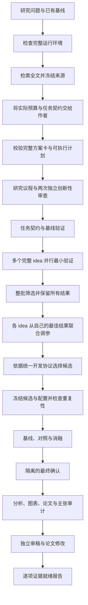

# 完整科研 Harness

`scripts/research-agent harness` 将研究准备、实验、论文和审稿放在同一工作区。它复用 V3 执行器，并增加可恢复的阶段控制器、全文支持的创新性审查和证据就绪报告。目标是提高研究质量与可检查性。论文是否达到某个期刊或会议的标准，仍取决于实际贡献和证据。

## 工作流程



探索期间使用开发数据。阶段结束后的冻结重复检查仍属于开发证据。最终确认使用任务契约声明的另一组 seed 和隔离资源。增加 seed 不能代替新数据、患者独立性或外部队列；这些要求必须写入具体任务。

## 三个版本如何整合

| 来源 | 本项目保留的机制 | 实际实现 |
|---|---|---|
| V1 | 可复用任务起点、idea 有界反思、历史 idea 档案 | 实际适配 `generate_ideas.py` 的反思与档案序列化；每轮保留完整证据和模型回执 |
| V2 | Journal、MetricValue、分支选择、分阶段研究 | 实际源码适配用于搜索树节点排序；原单路自适应模式继续可用，新的组合调度器负责并行筛选和每个 idea 的调参历史 |
| V3 | coding agent、任务契约、封闭评价、对照消融、最终确认与论文审计 | 复用原有 pipeline 和执行器；每个阶段写入宿主生命周期记录 |
| 本次整合 | 把文献差异与实验依据连接起来 | 研究议程、最近工作全文片段、替代解释、判别实验、独立创新性审查与就绪报告 |

来源与修改见[实际代码复用清单](upstream-code-reuse.md)。V1/V2 适配模块保留原 AI Scientist Source Code License，V3 保留 Apache-2.0。运行时不依赖审查用的上游 checkout。三个版本继续共用一个执行链。

## 安装与运行

先准备 Python 环境、Docker 和所用 agent 的认证。现有完整 agent 镜像支持多个 agent。CPU/Codex 任务也可使用较小的专用镜像：

```bash
uv sync --frozen --group dev --index-url https://mirrors.aliyun.com/pypi/simple
./scripts/build-research-cpu-image.sh
```

专用镜像包含 Codex、固定版本的 Headless、Python、LaTeX 和 PDF 工具；新构建还包含用于替代文本提取的 Poppler。任务自己的依赖由受管理的任务环境安装。镜像不包含个人凭据，也不包含 GPU/PyTorch 训练环境。

macOS 完整运行还需要 Linux 运行器。运行状态和临时文件必须放在 Docker 原生 volume 中。macOS 共享目录不能可靠执行这里使用的原子目录替换和恢复操作；启动检查会在调用模型前发现这类问题。

```bash
./scripts/build-research-runner-image.sh
./scripts/run-research-harness-container.sh --native-state --state-info
./scripts/run-research-harness-container.sh --native-state --preflight
```

使用返回的 `native_root/workspaces/研究名` 作为 `--workspace`，并将下方命令的 `./scripts/research-agent` 换成 `./scripts/run-research-harness-container.sh --native-state research`。恢复使用同一原生工作区。运行后可导出本地只读副本；PDF、源码和证据可以检查，原始回执不会被改写。完整命令、认证配置与导出方法见 [Linux 运行器说明](../src/docker/research-runner/README.md)。

论文写作与修订的日志管道使用论文目录之外的私有运行时目录。即使进程被强制中断，残留管道也不会进入论文发布树。旧运行在论文目录中留下的管道，应先保存故障快照并确认相关进程已结束，再单独隔离；发布校验仍拒绝特殊文件。

恢复时若论文阶段已完成，后续审稿或修订会显式绑定工作区中已记录且未改变的论文目录。对应恢复预览也检查该输入配置；原有阶段路径限制和论文证据校验继续生效。

比较证据重读保留已保存摘要的变体顺序和完整描述绑定，并识别主机生成的 `brokered_search` 完成回执。控制组中已由主机实际评估的 `program_0` 可参与校验；其身份、完成状态、正确性和规范化 rubric 仍逐项检查。

论文写作和修订还会保留最终评估实际使用的程序源码，并在审计前与最终主机回执重新核对。`paper_data.json.final_program` 给出源码入口和论文内的相对路径；它与开发阶段的 `best_correct` 分开。源码对应关系支持方法描述，不能替代权重对应关系、独立确认或性能证据。

下面假设 `playground/my-study` 已有 `task.md` 与 `research.yaml`。如提供完整脚手架和 `task_contract.json`，Harness 可直接使用；只有研究说明时会进入任务构建阶段。

```bash
./scripts/research-agent harness playground/my-study \
  --workspace results/harness/my-study \
  --dry-run \
  agent.name=codex agent.profile=agsci-deepseek agent.model=deepseek-flash \
  container.image=unified-ai-scientist/research-cpu:2026.10 \
  container.env_file=
```

检查配置后，删除 `--dry-run` 执行。项目默认 profile 为
`agsci-deepseek`，直接访问 `https://api.deepseek.com/`。运行前设置
`DEEPSEEK_API_KEY`。模型可通过 `agent.model` 指定。文献服务在任务的
`research.yaml` 中配置，见[模型检索指南](model-search.zh-CN.md)。

模型按用途配置。框架不把任何阶段固定到 GPT 或 DeepSeek：

| 配置 | 用途 | 继承规则 |
|---|---|---|
| `agent.name/model/profile/reasoning_effort` | 研究议程、idea、代码与论文 | 使用该次运行选定的 agent |
| `review.agent_name/agent_model/agent_profile/agent_reasoning_effort` | `review.backend=agent` 时的独立创新性审查与论文审稿 | 未填写的字段继承 `agent.*`；每次审查仍使用新的上下文 |
| `literature.model_search` | 文献检索及检索结果解析 | 在任务 `research.yaml` 中单独配置，不随 `agent.model` 改变 |

例如，可让 DeepSeek Flash 负责作者工作，再为独立审稿配置另一个兼容 profile：

```bash
./scripts/research-agent harness playground/my-study \
  --workspace results/harness/my-study --dry-run \
  agent.name=codex agent.profile=agsci-deepseek \
  agent.model=deepseek-flash \
  review.agent_profile=REVIEW_PROFILE review.agent_model=REVIEW_MODEL
```

删去 `review.agent_model` 则让审稿继承作者模型；独立性来自新的上下文和独立证据回执。示例默认值只影响这个任务，不修改用户的全局 Codex 设置。

文献模型和搜索服务也可分别选择。支持服务端搜索且能返回结构化来源时使用 `native`；普通模型使用 `external`，由 Harness 实际请求所配置的搜索服务。仅更换模型名称不会自动赋予联网能力。详见[两条检索路径](model-search.zh-CN.md#两条执行路径)。

已冻结的完整原文也可通过[只读原文定位工具](source-lookup.zh-CN.md)提供给原生 Codex 调用。它返回可校验的字符区间 ID，并明确区分唯一匹配、重复匹配与缺失；模型仍需判断片段的科学含义。

在 research.yaml 设置 `harness.agent_source_lookup: true` 后，议程作者、V1 反思和原生创新性审查会自动配置单次调用的来源工具，保存来源与工具日志绑定，并在恢复时重放核验。该选项默认关闭；启用时需为原生调用明确配置 Codex 模型和 profile。

将 `harness.agent_python_image` 设为当前 Linux Docker 中已安装计算镜像的完整 `sha256:` ID，可为这些调用提供 `get_execution_policy` 和 `run_python`。空字符串表示关闭。此能力同样需要明确的 Codex 模型和 profile，可单独使用，也可与来源工具组合。每次调用使用私有 profile，仅为这两个工具设置批准规则；全局配置与终端的 read-only 权限保持不变。

宿主协调进程负责 Docker。模型生成的 Python 只在新的程序子容器中执行：无网络与 GPU、非 root、根文件系统只读、CPU 1 核、内存 512 MiB、最多 64 个进程、10 秒运行时间及 64 KiB 合并输出。每个原生上下文最多执行 12 个程序。代码和 JSON 输入分别限 32 KiB 与 64 KiB；程序通过 `INPUT_DATA` 取得输入。子容器仅挂载本次输入，不挂载凭据、来源目录或 Docker socket。镜像需包含 `/opt/research-runner/venv/bin/python`。

research-runner 的项目依赖不包含 PyTorch。需要直接执行论文模型的 CPU forward 检查时，可使用[离线 PyTorch 计算镜像配方](../src/docker/finite-python/Dockerfile.offline-torch)。基础镜像必须已有固定的 wheelhouse，默认目录为 `/opt/portfolio-wheelhouse`，其中需包含指定 PyTorch 版本及其全部依赖。构建时从本地 wheelhouse 安装到专用 venv，不下载包，也不修改基础镜像。将下面的基础镜像 ID 替换为已核验的完整 ID：

```bash
docker build --network=none --pull=false \
  --build-arg FINITE_PYTHON_BASE=sha256:YOUR_VERIFIED_BASE_IMAGE_ID \
  --build-arg TORCH_REQUIREMENT=torch==2.11.0 \
  -f src/docker/finite-python/Dockerfile.offline-torch \
  -t unified-ai-scientist/finite-python-torch:local \
  src/docker/finite-python
docker image inspect unified-ai-scientist/finite-python-torch:local --format '{{.Id}}'
```

把输出 ID 填入 `harness.agent_python_image`。先在相同预算下检查实际 import 和所需的小型 forward；镜像标签或 wheelhouse 中存在安装包，不代表隔离解释器已经安装该包。此配方安装 PyTorch 及其依赖，不自动补齐论文训练依赖。即使 wheelhouse 中的构建带有 CUDA 库，程序子容器仍不请求或挂载 GPU；执行限制保持不变。

程序、输入、实际输出、隔离条件与执行收据均绑定到该次提示词。取消或超时会停止服务并清理程序容器；恢复时先核验独占租约、容器 ID 和所有权标签。无法确认容器身份或清理结果时，保留私有恢复记录并拒绝将调用保存为完成状态。缓存重放只校验证据，不在宿主机执行模型代码。执行收据证明本次运行与保存字节的关系，科学含义仍由研究设计、原文证据和独立审查判断。

DeepSeek 直连使用公网地址，容器不需要访问宿主网关。通过
`RESEARCH_RUNNER_ENV_FILE` 或调用环境提供 `DEEPSEEK_API_KEY`；不要把凭据加入
任务目录或 Git。

从中断点恢复：

```bash
./scripts/research-agent harness --resume results/harness/my-study
```

已完成阶段必须通过保存的文件哈希检查。调查阶段会保留待完成的工作记录，并复用已验证的结果。恢复不能静默改变任务、评价协议或自适应策略；更改研究设计应创建新的工作区。

运行环境在首次初始化时失败，也可用同一条 `--resume` 命令重试。Harness 必须先核对宿主失败事件、任务快照、原预算和运行锁，并确认尚无实验产物或最终确认活动。检查通过后，启动日志和空隔离目录会完整移入 `startup_recovery/`，再重新初始化；文献、初始评审和任务封存标记继续保留。`--dry-run` 会显示 `initial_runtime_retry: true`，但不移动文件。有研究检查点时继续使用普通恢复；只有部分代码或未知文件、却没有可用检查点时，自动重试会停止。

首次准备也支持同一条恢复命令。`research_preparation.json` 在复制输入前保存配置，再封存输入与文献哈希。初始议程、反思或独立审查中断时，恢复会校验并复用已完成的调用，只继续未完成的调用。生成议程与披露标记会先记录预期内容，再写入冻结输入，因此部分写入也可恢复。准备未完成时不启动实验。

在线检索失败且没有来源时，准备保持可重试状态；已有本地来源时允许带有检索错误的 `partial` 文献状态继续。已封存的文献不会重新获取。文献阶段自身尚未封存的失败或中断记录保存在 `preparation_attempts/`；只有调用方显式执行 `--resume` 后，才重新执行该阶段，可能重复该阶段请求。含糊的付费 POST 失败不会在同一尝试内自动重试。完成回执、输入或文献校验失败时停止，不用新的请求掩盖变化。旧版本没有准备记录或完整调用配置指纹的工作区不能自动接续首次准备。

仅验证部分阶段时，显式使用 `--quality-target development`。完整 Harness 默认使用 `high_impact` 目标并要求所有研究阶段。该字段是检查要求，不是论文质量结论。

## 完整 idea、并行调参与预算

新 Harness 默认使用 `configs/preset/research_harness.yaml` 中的 portfolio 模式。
多个 worker 共用一个宿主控制器和总预算。GPU 按明确的设备池分配，单个 worker
只接收自己的设备。配置要求容器执行、每个候选一次宿主评价，并关闭旧的周期剪枝。

关键参数通过 `investigation.portfolio.*` 设置：

| 参数 | 默认值 | 作用 |
|---|---:|---|
| `initial_ideas` | 4 | 首批完整 idea 数；整批完成后再晋级 |
| `promote_ideas` | 2 | 进入联合调参的 idea 数 |
| `tuning_trials_per_idea` | 4 | 每个晋级 idea 的调参次数 |
| `replication_evals` | 2 | 最终冻结候选的开发协议重复次数 |
| `max_valid_evals` | 14 | 筛选、调参与重复检查的总上限 |
| `max_transport_failures` | 6 | 基础设施/API 失败上限 |
| `min_improvement` | 0 | 比较开发分数的最小改善阈值 |

网络失败不消耗有效科学评价次数。评价器完成但正确性判据失败的实验，会计入证据和预算，但不会晋级为最佳候选。重复实验不能凭一次较高分数替换已冻结的获选代码。

新建在线 portfolio 工作区若已提供完整任务骨架，会先生成
`research_context/host_context.json`。它包含已解析的
实际预算、worker 数、允许公开的任务契约和起始代码。起始代码标为尚未评价。作者
直接读取这些内容，无需在独立会话的临时目录中查找原任务。该包不包含保留集数据
或标签。
从简短题目开始时，先生成并核验任务骨架，再用实际合同和预算生成执行计划。
新在线工作区将原始骨架保存在 `campaign/postdraft/drafted_task/`，将计划版本保存在
`campaign/postdraft/planned_task/`。作者、计划编译、独立审查及发布均有恢复记录。
计划封存完成后才启动 investigation。`input_task/` 与初始审查保持原样；论文分别
报告初始议程、生成骨架后的执行议程及实际实验依据。旧工作区恢复时不自动启用此流程。

作者在议程的 `execution_plan` 中提交完整方案卡和分配表。宿主检查方案数、每个
方案的一次筛选、晋级数量、晋级后的调参次数和冻结重复次数。计划不符合实际
执行能力时，将具体错误交给作者反思；最后一轮仍不合法，就停在计划检查点，
不开始独立评审或实验。不能把下游程序修复次数上限算作已安排的 HPO 次数。

合法计划冻结为 `research_context/campaign_plan.json`。调度器按其中的完整卡创建
root，并绑定卡片、议程和预算哈希。创新类别由方案决定，允许重复，不要求凑齐
六类。首次筛选实施该方案；后续调参保留同一研究问题和贡献。

若需要所有通过正确性检查的方案都进入联合调参，设置 `promote_ideas` 等于
`initial_ideas`。例如三个方案各筛选一次、各调参四次，再做两次冻结重复，合计
17 次评价。默认的四个方案晋级两个，只保证晋级方案的调参次数。计划中的
`control` 方案与其他 root 使用相同的试验规则；启动时的基线验证不等于已调优对照。

进入最终评价前，宿主冻结 `comparison_set.json`：其中包括开发阶段获选的方法，
以及每个声明对照各自的最佳版本。集合绑定计划、源码、执行配置、宿主回执和
实际调参次数。每个方法使用相同的封存协议。已完成的方法只读复用；已调用但
未完成的方法保留失败状态，不能用重跑替换。最终分数不用于改选方法。

若评价器提供预先声明的配对预测证据，宿主可计算各方法与全部对照的差值和
区间。当前支持二分类多视图 AUROC：各条件取最差视图，再对条件和种子求均值；
bootstrap 保持方法、条件和视图配对，并对训练种子和正负样本重采样。论文同时
保留每个对照的结果。固定默认参数的诊断基线不能替代这些经过调参的对照。

完整 idea 可以围绕问题、效率、数据使用、目标函数、优化或结构展开。先实现一个
可检验的整体方案，再联合调整任务允许的参数。每个 idea 保留自己的最佳父版本，
不会因另一 idea 分数更高就换掉研究方向。同一 idea 内的问题、贡献、协议与允许
参数空间保持固定；改动这些内容应成为新 idea 或新任务。需要不同数据或指标的
研究问题不能直接加入同一个分数排名。

新工作区将策略冻结在 `research_context/whole_idea_policy.json`。旧工作区保留其原有
配置与策略，恢复不自动升级。筛选、调参、失败、未入选结果和配置都保存在完整
ledger 中。论文可以选择有解释力的比较，但必须说明选择理由，并保留完整记录。
独立调参的方法比较、匹配条件的组件消融、配置敏感性分析是三类不同证据。

已有作者草稿可作为新任务的 `research_seed_agenda.json` 输入，使用
`schema_version: 1`、`agenda` 和非空的 `derived_from` 来源说明。它是待修订的
提案，仍须对齐新预算并接受审查。旧调用及原始回执保持原样；新提案修订使用
新目录。旧工作区缺少新计划文件时，恢复保留旧流程，不自动改写冻结研究。

开发 handoff 分别记录选择时的提升和固定候选的复验均值。只有两者均超过阈值，
才支持有限的开发均值改善判断。它不代表统计显著性或独立确认。若所有新方法弱于
基线，保留基线并标记未产生新赢家。

原 `investigation.adaptive_investigation.*` 单路模式仍要求 `workers=1`，不能与
portfolio 同时启用。普通 V3 并行流程也继续保留。新 portfolio 的子任务复用现有
V3 编码、宿主评价、收据与进程清理，不启动另一套评价器。

新建搜索树使用选择策略版本 2：先按源码哈希合并探索候选，再限制候选宽度；同一源码的访问次数合计。完整实验节点、假设和证据继续保留。已有树缺失版本号或保存版本 1 时保持原规则，恢复不会自动升级，已分配的父节点也不会改变。

## 创新性如何检查

研究议程应写清：研究问题、具体新增贡献、价值、适用范围、最近工作、重合与差异、替代解释及判别实验。已存在类似工作不自动否定方向。有意义的增量贡献可以继续发展。

审查需要读取保存的来源全文。结构检查验证引用区间、文本及哈希；两个新的模型上下文判断实际差异。没有可追溯回执的作者断言不能把状态提升为 `supported`。

PDF 的页覆盖与文本质量分别记录。默认仍用 pypdf；若检测到大量编码字体转义碎片，则尝试有 20 秒、2 MiB 输出限制的本地 `pdftotext -layout`。替代结果需覆盖相同的全部非空页面、通过该诊断，并保留足够文本长度。提取方法、原始 PDF 哈希、所选文本哈希、页数和诊断保存在来源的 `extraction` 字段，并传给作者与审查者。缺少工具或替代提取失败时，问题文本保留为 `full_text_unreliable`，不能补足完整原文引用要求。该诊断只处理已知字体碎片问题，不验证全文语义或所有数学字形。旧来源包和回执不重新提取或改写。

不同解析器或版本可能生成不同的文本字节。搬移工作区时，须携带已冻结的全文和 catalog；不能重新提取后继续使用旧引用偏移与审查回执。

作者与独立审查接收相同的已准备来源文本。审查包包含全部已保存全文，包括没有列入 `closest_work`、但在 `source_selection` 或 `source_scan` 中被比较或排除的来源。只有元数据的来源仍明确标记为 `metadata`。完整来源包继续使用 600,000 字符上限；超限会在调用审查模型前停止，不截断全文，也不提高上限。审查回执保存来源包哈希与覆盖清单。恢复或读取缓存时，还会将已保存提示中的来源包与当前完整包核对；旧版只传入部分全文的审查会降为 `needs_evidence`，不能沿用旧 `supported` 状态。

初始议程审查与选中候选审查均并行运行 2–4 名独立 reviewer。作者草拟与反思仍按依赖顺序串行执行。全部共享输入及恢复记录先通过校验，再启动缺少有效结果的 reviewer。每名 reviewer 使用独立目录，最终按编号汇总。一次失败会保留其他已完成结果，恢复只重试未完成的调用。

旧版选中候选审查在恢复时，也会保留完整且输入未变的否定或待补证据结论。复用前重新核对来源、候选代码与结果、原始模型响应、配置和 reviewer 数量；只保存一个状态标签不足以复用。缺少回执、绑定失效或评审未完成时，仍需新的审查。复用不会把 `needs_evidence`、`overlap` 或 `no_novelty_claim` 改成 `supported`。

主线程收到 SIGTERM 或 SIGINT 后，会取消 agent 调用，等待所有审查进程树清理完成，再退出。非主线程调用可显式传入 `cancel_event`。HTTP 后端保留原有超时语义；取消后仍等待已发出的请求结束，不声称能停止服务端计算。

| 状态 | 含义 |
|---|---|
| `supported` | 保存的文献证据和独立判断支持这项有限的拟议贡献 |
| `needs_evidence` | 来源、比较、判断或实验设计仍有缺口 |
| `overlap` | 两次有来源依据的判断认为核心贡献严重重合 |
| `no_novelty_claim` | 本次工作是复现等类型，不提出新颖性主张 |

摘要可用于初筛、判断主题相关性和形成暂定想法。关键方法、设置和贡献边界仍需全文证据；只有摘要时保留 `needs_evidence` 与待核实项，可以继续发展 idea，不把缺少全文等同于方向无价值，也不声称已验证 novelty。

`supported` 不代表实验成功，也不代表文献检索已经穷尽。最终选中的候选会单独接受审查，不能沿用另一个 idea 的结论。

候选审查通过宿主核验后，单独写入 `paper_data.json` 的 `selected_novelty_review`，并进入写作、审稿和证据审计的上下文。它绑定当前候选代码、开发评价回执、来源、审查 cycle 和原始模型响应；初始议程反馈仍单独保留。缺失、过期或无法复验的反馈明确降为 `needs_evidence`，不能从任意同名文件取一个 `supported` 状态。论文恢复与审计前重新核验；审计后到最终导出期间，绑定证据改变则停止完成判定。该反馈不证明最终确认成功，也不授权在看过最终 holdout 后调参或更换候选。

新在线工作区的候选审查可进入有预算的补证据流程。只有经过收据复验的文献请求
才触发检索。默认最多补两轮；每轮最多处理四个请求，加入四篇可用全文。总调用、
下载字节和经过时间都有上限，恢复不会重置预算。设计、执行或统计缺口仍保留为
未解决问题。没有新全文、重复请求、预算耗尽或核心贡献重合都会停止补证据。

检索优先使用已配置的 HTTP 搜索后端。未配置时，使用当前作者 agent 提供论文线索。
该 CLI 的返回值不含结构化网页工具收据，因此这些线索始终标为未核实。宿主另行
下载公开主来源 PDF，保存原始字节，并检查前页题名和全文提取结果。网页与 PDF 的
论文标识必须一致；写入参考文献时，再将来源元数据的题名和标识与已读全文核对。
题名匹配不等于认证出版身份或科学结论。不能取得完整全文的线索不能补足全文证据要求。

每轮使用新的只含研究证据的任务视图，继承全部旧来源，并保留父评审和新增来源的
哈希。旧输入与已完成评审不改写。作者只能修订选中方法的解释、归因和贡献范围；
候选代码、配置、评价数据及执行计划不变。新的独立审查仍可给出负面结论。
最终确认调用或方法集合冻结后，不再启动自动补证据；已有完整记录可只读复验。

## 输出与完成判定

```text
WORKSPACE/
├── input_task/              # 冻结任务、全文与研究议程
├── novelty/                 # 初始与选中候选的独立审查
├── campaign/postdraft/      # 生成任务骨架后的计划来源链（适用时）
├── harness_state.json       # 阶段状态、事件和文件哈希
├── paper_readiness.json     # 可机读的证据缺口
├── paper_readiness.md       # 可阅读的就绪报告
└── run/
    ├── task/
    ├── investigation/      # portfolio_investigation.json、租约与完整记录
    ├── ablations/
    ├── final_evaluation/
    ├── posthoc/
    └── paper/              # PDF、LaTeX、引用、审计和审稿
```

就绪报告分别检查论文文件、实验回执、对照消融、最终确认、主张依据、独立审稿和创新性。全部通过才标记 `ready_for_human_review`。流程返回成功、PDF 能打开、模型建议接收，都是不同事实。最终结果为负时仍可生成诚实论文，并明确证据缺口。系统不会自动向期刊或会议投稿。

论文写作上下文会直接列出 `research.yaml` 的就绪要求及配置哈希，不复制模型服务设置。正效应检查要求效应值和区间下界都严格大于声明阈值。写作时必须区分这些配置要求、作者议程和实际执行协议；样本量、bootstrap 次数及结果以评价证据为准。配置要求本身不能证明检查通过。

## 手稿独立评审（`critique`）

研究流程内的审稿阶段由 `src/pipeline/review.py` 负责。若要在管线之外对任意草稿做独立评审，
使用：

```bash
agsci research critique path/to/NOTE.tex \
  --output critique-01 \
  --model deepseek-flash --profile agsci-deepseek \
  --reviewers 2
```

每个评审使用独立的模型上下文、同一份 rubric，并只返回固定 schema 的 JSON：
`verdict`、`blocking`、`non_blocking`、`prior_art_gaps`、`venue_fit`、
`required_extra_evidence`、`verdict_reasoning`。模块会校验 schema、为每位评审写出
`reviewer_<i>/assessment.json` 与调用回执，并合并为 `critique_report.json`。
报告显式记录独立性上限：可能是同一模型的多次独立调用，不构成人类同行评审。
命令不修改手稿；输出目录已有评审时拒绝覆盖。

评审是随机的：不同轮次会提出不同意见，因此"再跑一轮通过"不能当作收敛判据，
只能作为修订输入。人类评审仍是必需的。

## 有限诊断（`mil_assumption_audit`）

对有限 MIL 构造做精确、可复算的诊断：

```bash
python -m src.research.audit.mil_assumption_audit task.json --output report.json
```

`task.json` 提供 `points`（内容/环境类型）、`bags`（实例索引与 OR 标签）、可选
`permutation`。报告包含：相容布尔映射与 support、forced/unresolved 证书、
组成矩阵及其精确秩、A4/A5 集合（含置换后对比）、target-blind 自适应查询最优、
target-aware teaching 成本。全部用整数与 `fractions.Fraction`，无第三方依赖、无随机抽样。

## 复现包校验（`verify-bundle`）

```bash
agsci research verify-bundle reproduction-bundle.tar.gz \
  --manuscript NOTE.tex \
  --expect-hash <manifest-sha256>
```

复现包是含 `MANIFEST.json`（`{"files": {相对路径: sha256}}`）的目录或 `.tar.gz`。
校验是精确的：列出的文件必须存在且字节一致，不允许未列出的文件，拒绝符号链接；
若给出 `--manuscript`，正文必须引用 manifest 的 SHA-256，防止重建包后正文仍引用旧哈希。
命令在失败时返回 1。

注意：正文应引用 **manifest 哈希**（内容指纹），而不是 tar.gz 的哈希（会随压缩元数据变化）。
在 macOS 上用 `COPYFILE_DISABLE=1 tar --no-xattrs --no-mac-metadata` 打包，
否则归档会混入 `._*` AppleDouble 文件，被校验判为未列出文件。

## 复现包进入就绪判定

当 `run/paper/` 下存在 `reproduction-bundle-*.tar.gz` 时，`paper_readiness.json` 会自动增加
`evidence_bundle` 检查：包必须与 `MANIFEST.json` 完全一致，且 `paper.tex` 必须引用该 manifest
的 SHA-256。检查失败会把就绪状态降为 `evidence_gaps`，并给出 `repair_manuscript` 动作。
没有复现包时该检查不出现，不构成缺口。多于一个复现包或缺少 `paper.tex` 都判为无效。

## 确定性复现包构建（`bundle_build`）

```bash
python -m src.research.audit.bundle_build --root <证据目录> \
  --output reproduction-bundle.tar.gz note.tex runs evidence.json
```

按显式条目列表收集文件（目录递归、自动跳过 macOS `._*`），写 `MANIFEST.json`，
并产出两次构建**字节完全相同**的 `.tar.gz`：tar 成员 mtime/uid/gid/mode 固定，gzip 头
`mtime=0` 且不写文件名。拒绝符号链接、`..`/绝对路径与空条目。与 `verify-bundle` 配对使用。

## 证书表格一条命令复现（`certificate_tables`）

```bash
python -m src.research.audit.certificate_tables --root <证据目录> --records <记录目录>
```

从原始 MUSK CSV 与 Corel/TREC9 svm-light 文件重算每个数据集的证书统计，与已保存的
JSON 记录逐字段比对；任何不一致返回非零。用于防止手稿表格与测量结果漂移。

## 案例研究：OR-MIL 证书审计（2026-10）

真实案例走通了完整链路，产出两篇论文（证据与手稿在 `scratch/`，不入库）：

1. **A certificate audit of OR-MIL instance identifiability**（13 页）：
   FocusMIL A1–A5 的有限见证（9 个相容映射、π=(0 2)(1 5) 保袋）、A4/A5 边缘读法、
   VIB 目标置换对称性、forced/unresolved 证书、认证成本下界、12 个数据集的证书统计、
   随机系统模拟、查询负结果、learned-vs-certified 对照。
2. **Standard OR-MIL benchmarks distribute bag labels as instance labels**（4 页）：
   从归档生成脚本确认"逐实例标签"实为袋标签传播；10 个数据集全部 label-pure；
   标签传播基线 F1=1、prevalence 基线对照下 linear/max 10/10 低于、attention 7/10 高于。

### 经验

- **哈希纪律**：手稿只引用 manifest 哈希；`verify-bundle` 现在会拒绝正文中任何
  "bundle/manifest" 上下文里出现的陈旧 64 位哈希。
- **评审循环**：5 轮模型评审共 31 条 blocking，修复了过度声明、度量语义、
  形式化边界、查询模型与数据来源等真实问题；模型评审不是人类评审，需在附录中声明。
- **实验对照**：弱基线会制造虚假结论。加神经基线后发现"模型打不过平凡基线"只对
  linear/max-pooling 成立；核查数据来源后发现实例标签根本不是独立标注。
- **结论**：对 benchmark 的元数据（标签如何生成、袋是否混合）做审计，
  与对方法做审计同等重要；这类审计往往比再加一个模型更能暴露问题。
